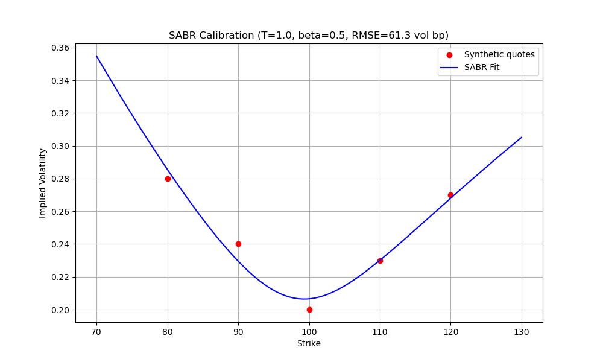
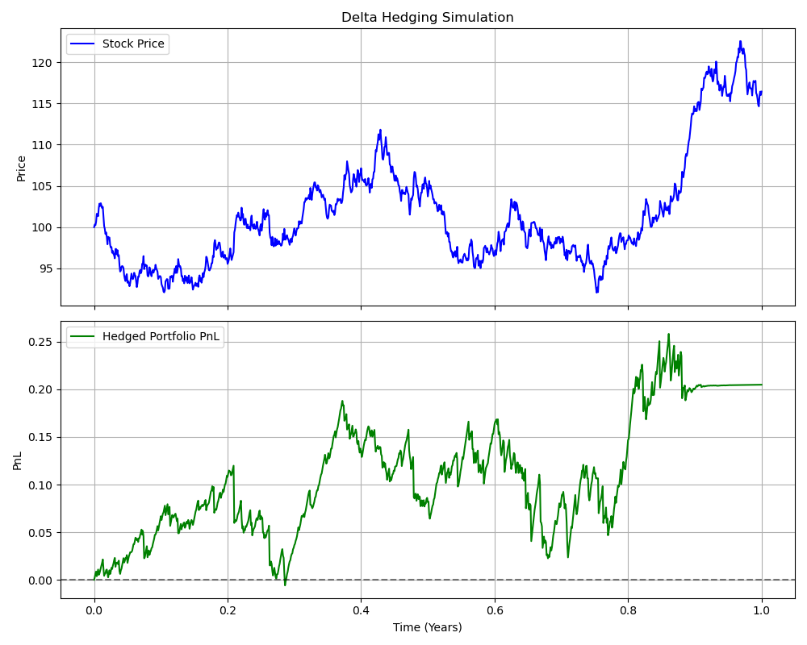

# Quantitative Options Pricing Library

[](https://opensource.org/licenses/MIT)
[](https://www.python.org/downloads/)

A Python library for pricing equity options with several numerical methods and comparing them against each other: closed-form Black-Scholes, binomial and trinomial trees, a Crank-Nicolson finite-difference solver and Monte Carlo simulation. It also includes SABR and Heston stochastic-volatility models, an implied-volatility surface and a delta-hedging simulator.

## Features

### Pricing engines
*   **Analytical:** Black-Scholes-Merton prices for European calls and puts, with closed-form Delta, Gamma, Vega, Theta and Rho.
*   **Trees:** Cox-Ross-Rubinstein (CRR) binomial and Kamrad-Ritchken trinomial lattices for European and American exercise, with optional averaging of N- and (N+1)-step prices to damp CRR's odd/even oscillation.
*   **Finite differences (PDE):** θ-scheme on a uniform spot grid (Crank-Nicolson by default) with Dirichlet boundary conditions. American exercise is handled with Projected Successive Over-Relaxation (PSOR).
*   **Monte Carlo:** geometric Brownian motion paths with antithetic variates or control variates. American options are priced with Longstaff-Schwartz least-squares regression. Delta uses the pathwise estimator; the other Greeks use bump-and-revalue.

### Volatility models
*   **Implied volatility surface:** Brent root-finding on the Black-Scholes price, with bilinear interpolation in (strike, expiry).
*   **SABR:** full Hagan et al. (2002) lognormal implied-volatility approximation. β is fixed by the user (default 0.5); α, ρ and ν are calibrated to a single-expiry smile with L-BFGS-B, and the fit RMSE is reported.
*   **Heston:** semi-analytical pricing by numerical integration of the characteristic function, calibrated to a single-expiry smile with L-BFGS-B.

### Hedging
*   **Delta-hedging simulator:** Monte Carlo simulation of discretely rebalanced delta hedging of a short option under geometric Brownian motion.
*   **P&L attribution:** decomposition of option P&L into delta, gamma, theta and vega terms.

### Testing
*   `pytest` suite covering convergence to analytical prices, put-call parity and early-exercise behaviour, including a test that runs every example in this README.
*   GitHub Actions runs the suite on Python 3.10, 3.11 and 3.12.

## Scope and limitations
*   No dividends: every engine assumes a non-dividend-paying underlying.
*   Vanilla payoffs only. A barrier contract class exists, but no engine prices barriers; Asian options are not implemented.
*   Greeks are available from the analytical and Monte Carlo engines only, not from the trees or the PDE solver.
*   All examples and tests use synthetic inputs; the library does not download market data.

## Visuals


*SABR fit to a synthetic volatility smile (`examples/03_sabr_calibration.py`).*


*One simulated delta-hedging path (`examples/05_delta_hedging_sim.py`).*

## Installation

```bash
git clone https://github.com/Alexios99/Quantitative-Options-Pricing-Library.git
cd Quantitative-Options-Pricing-Library
pip install -e .
```

## Usage

### 1. Black-Scholes pricing

```python
from quantlib.core.payoffs import OptionContract, OptionType, ExerciseStyle
from quantlib.pricing.analytical import BlackScholesEngine

# European call: Spot=100, Strike=100, T=1yr, r=5%, vol=20%
option = OptionContract(spot=100, strike=100, time_to_expiry=1.0,
                        risk_free_rate=0.05, volatility=0.2,
                        option=OptionType.CALL, style=ExerciseStyle.EUROPEAN)

engine = BlackScholesEngine()
price = engine.price(option)
greeks = engine.greeks(option)

print(f"Call Price: {price.price:.4f}")
print(f"Delta: {greeks.delta_call:.4f}")
```

### 2. Monte Carlo pricing

```python
from quantlib.core.payoffs import OptionContract, OptionType, ExerciseStyle
from quantlib.pricing.monte_carlo import MonteCarloEngine

option = OptionContract(spot=100, strike=100, time_to_expiry=1.0,
                        risk_free_rate=0.05, volatility=0.2,
                        option=OptionType.CALL, style=ExerciseStyle.EUROPEAN)

# 100,000 paths, 50 time steps, fixed seed for reproducibility
mc_engine = MonteCarloEngine(n_steps=50, n_paths=100000, seed=42)
mc_result = mc_engine.price(option)

print(f"MC Price: {mc_result.price:.4f} +/- {mc_result.standard_error:.4f}")
```

### 3. Volatility modelling

#### Implied volatility surface
Build a surface from option quotes and interpolate implied volatility.

```python
from datetime import datetime
from quantlib.calibration.implied_vol import VolatilitySurface
from quantlib.utils.market_data import MarketQuote, OptionType

surface = VolatilitySurface(spot_price=100.0, risk_free_rate=0.05)

# Synthetic quotes
chain = []
for k, price in [(90, 14.5), (100, 8.5), (110, 4.5)]:
    chain.append(MarketQuote(
        symbol="EX", strike=k, bid=price-0.05, ask=price+0.05,
        time_to_expiry=1.0, option=OptionType.CALL, timestamp=datetime.now()
    ))
surface.add_chain(chain)

# Interpolated implied volatility (bilinear)
iv = surface.get_iv(strike=105, expiry=1.0)
print(f"Interpolated IV at Strike 105: {iv:.4f}")
```

#### SABR calibration
```python
from quantlib.calibration.sabr import SABRCalibrator

# Synthetic smile: list of (strike, implied vol)
market_data = [(90, 0.24), (95, 0.22), (100, 0.20), (105, 0.19), (110, 0.195)]
forward = 100.0
expiry = 1.0

# beta is fixed (default 0.5); alpha, rho and nu are fitted
calibrator = SABRCalibrator(beta=0.5)
result = calibrator.calibrate(market_data, forward, expiry)

print(f"SABR Alpha: {result.params.alpha:.4f}")
print(f"SABR Rho: {result.params.rho:.4f}")
print(f"SABR Nu: {result.params.nu:.4f}")
print(f"Fit RMSE: {result.rmse_bp:.1f} vol bp")
```

#### Heston pricing
```python
from quantlib.calibration.heston import HestonParameters, HestonPricingEngine

params = HestonParameters(
    v0=0.04,     # Initial variance
    kappa=2.0,   # Mean reversion speed
    theta=0.04,  # Long-run variance
    sigma=0.3,   # Vol of vol
    rho=-0.7     # Correlation
)

engine = HestonPricingEngine()
price = engine.price(spot=100, strike=100, time_to_expiry=1.0,
                     risk_free_rate=0.05, params=params)

print(f"Heston Call Price: {price:.4f}")
```

### 4. Delta-hedging simulation

Simulate discrete delta hedging of a short call under geometric Brownian motion.

```python
from quantlib.hedging.delta_hedging import DeltaHedging

# Spot=100, Strike=100, 3 months, 20% vol
hedger = DeltaHedging(S0=100, K=100, T=0.25, r=0.05, sigma=0.20)

# 1,000 simulated paths, rebalanced at each of 50 steps
results = hedger.simulate_hedging(n_steps=50, n_simulations=1000, hedge_frequency=1)
analysis = hedger.analyze_results(results)

print(f"Mean Hedging Error: {analysis['mean_hedging_error']:.4f}")
# Visualise with: hedger.plot_simulation(results)
```

## Testing

```bash
pytest quantlib/tests
```

## License

This project is licensed under the MIT License - see the [LICENSE](LICENSE) file for details.

## Author

**Alexios Philalithis**
